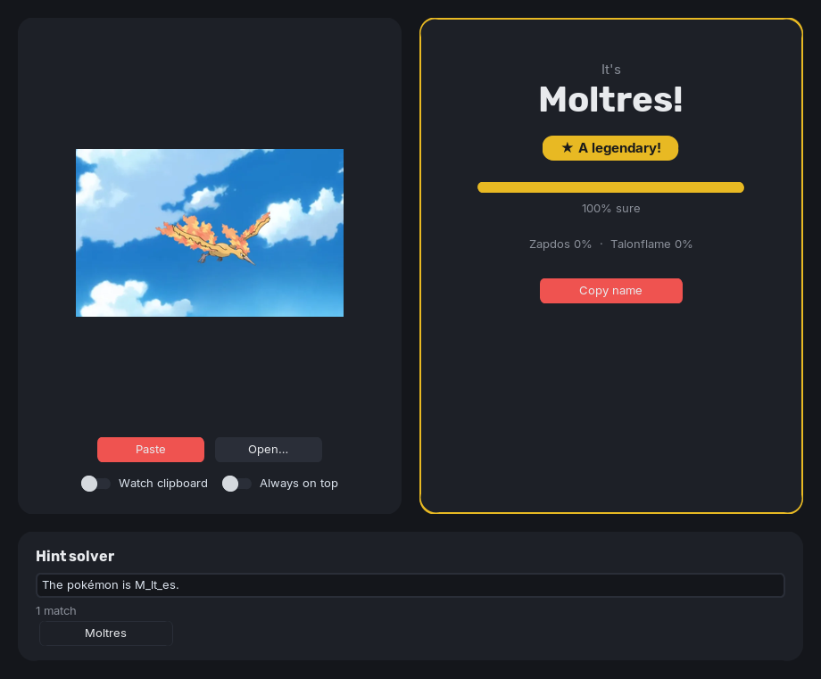

# outn-local

Desktop version of [OutN](https://github.com/Pranjal-SB/OutN). Copy a Pokétwo spawn
image, paste it in, and it tells you who's that Pokémon. No Discord bot needed.



- Ctrl+V or Open… to identify, or turn on **Watch clipboard** and just copy images
- shows how sure it is, and the next two guesses
- rare and regional spawns get a badge
- hint solver: paste the hint or type `p_k_chu`

## Run

Needs Python 3.10–3.13 (TensorFlow has no wheels for 3.14 yet).

### Windows

```
py -3.12 -m venv .venv
.venv\Scripts\python.exe -m pip install -r requirements.txt
.venv\Scripts\python.exe app.py
```

### Linux

uv's Python builds ship a Tk without Xft, so the bundled fonts don't render. Use a Tk built with Xft, e.g. conda-forge's, kept inside the project with
[micromamba](https://mamba.readthedocs.io/en/latest/installation/micromamba-installation.html):

```
mkdir -p .tools && curl -fsSL https://micro.mamba.pm/api/micromamba/linux-64/latest | tar -xj -C .tools bin/micromamba
MAMBA_ROOT_PREFIX=$PWD/.tools/mamba .tools/bin/micromamba create -y -p $PWD/.conda -c conda-forge python=3.12 'tk=*=xft*'
.conda/bin/python -m pip install -r requirements.txt
.conda/bin/python app.py
```

Clipboard paste on Wayland needs `wl-clipboard`.

The first launch takes ~15 s while the model loads.

## Self-check

```
.venv\Scripts\python.exe test_core.py   # Windows
.conda/bin/python test_core.py          # Linux
```
